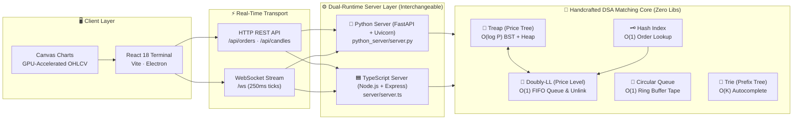
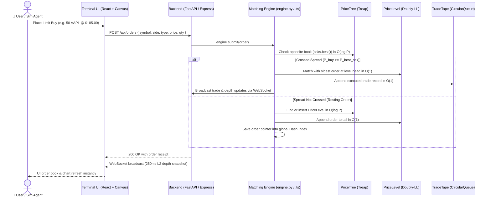
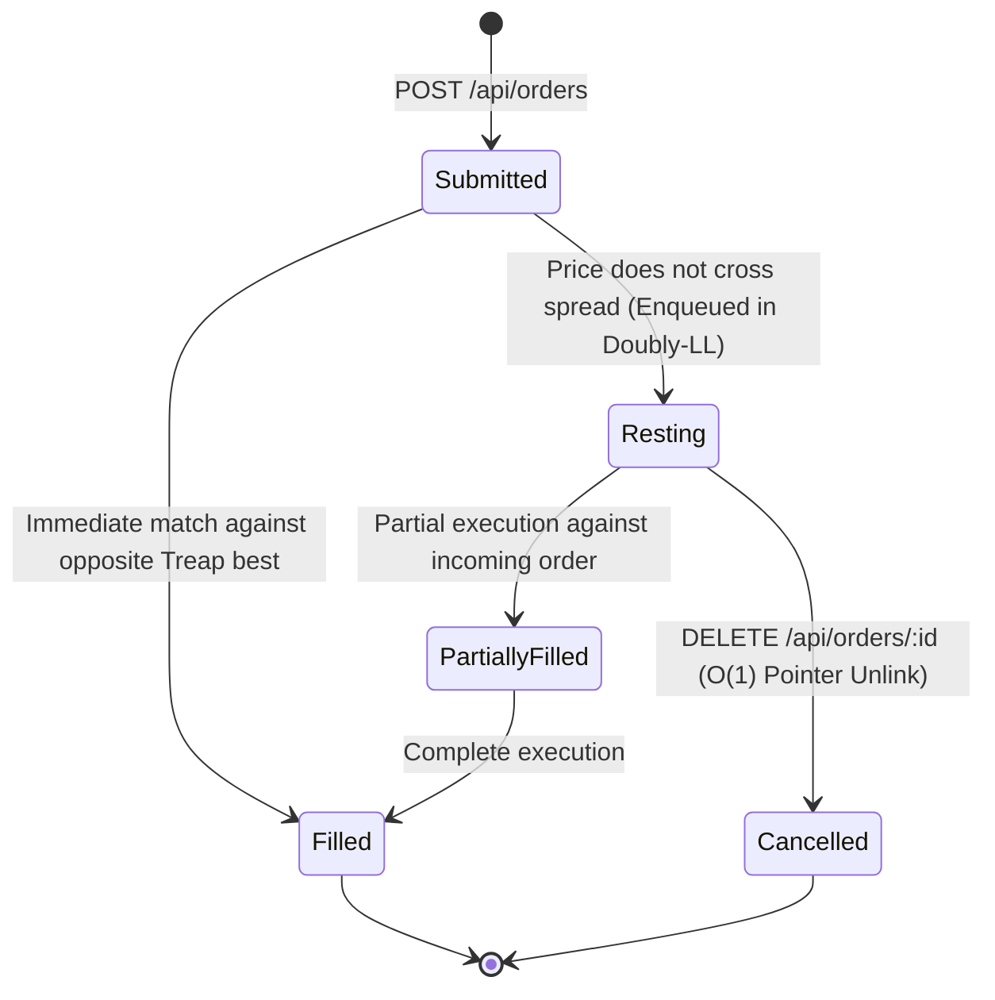

<div align="center">



<a href="https://github.com/AadityaBarapatre/Meridian">
  
</a>

<br>


**[The Idea](#-the-idea)** · **[Architecture](#-architecture)** · **[Features](#-features)** · **[Screenshots](#-screenshots)** · **[DSA Deep Dive](#-dsa-deep-dive)** · **[Tech Stack](#-tech-stack)** · **[Quick Start](#-quick-start-windows)** · **[API Reference](#-api-reference)** · **[Evaluators](#-for-evaluators-where-to-look)**

</div>

---

## 💡 The Idea

An electronic financial exchange processes tens of thousands of bids, asks, cancellations, and trades every second under microsecond Service Level Agreements (SLAs). In high-frequency trading (HFT), naive data structures (arrays or flat linked lists) fail completely: finding best prices takes $O(N)$, cancellations degrade under linear scans, and frequent memory allocations trigger catastrophic Garbage Collection (GC) latency spikes.

**Meridian** solves these real-world exchange engineering challenges from first principles. Built with **zero third-party data structure libraries**, every component is handcrafted across a **dual-runtime matching engine** featuring complete architectural parity in both **Python 3 (FastAPI)** and **TypeScript (Node.js)**.

| In the Financial Exchange | Real-World Challenge | Handcrafted Data Structure / Algorithm | Asymptotic Efficiency | Where in Code |
|---|---|---|:---:|---|
| **Price Priority** | Highest bids & lowest asks must execute first | **Treap (Cartesian Tree: BST + Max-Heap)** | $O(\log P)$ | `PriceTree` (`engine.py` / `engine.ts`) |
| **Time Priority** | Orders at the same price execute First-In, First-Out (FIFO) | **Doubly Linked List** | $O(1)$ enqueue / dequeue | `PriceLevel` (`engine.py` / `engine.ts`) |
| **Instant Order Cancellation** | 90%+ of orders get cancelled before fill; cannot scan $O(N)$ | **Global Hash Index + $O(1)$ Pointer Unlink** | $O(1)$ arbitrary cancel | `Engine.index` + `lv.unlink()` |
| **Real-Time Trade Tape** | Live execution stream without memory leaks or GC churn | **Circular Queue (Bounded Ring Buffer)** | $O(1)$ wrap-around write | `CircularQueue` (`engine.py` / `engine.ts`) |
| **Ticker Search Autocomplete** | Instant multi-asset search as the user types symbol prefixes | **Trie (Prefix Tree) + Recursive DFS** | $O(K)$ ($K$ = prefix len) | `Trie` (`engine.py` / `engine.ts`) |
| **L2 Order Book Ladder** | Depth ladder must be rendered without $O(N \log N)$ sorting | **In-Order & Reverse In-Order Tree Traversal** | $O(D)$ ($D$ = depth levels) | `PriceTree.top()` |
| **Financial Settlement** | Binary IEEE-754 floating-point drift destroys balances | **Scaled Integer Cent Arithmetic** | Exact integer cents | Throughout engine (`round(P * 100)`) |

> [!NOTE]
> Meridian is an academic order matching engine and paper trading simulator designed for **Course Code: 24EE05TH0505 – 2 (Data Structures and Algorithms)**. It runs entirely on your local machine with $100,000 in simulated demo capital. No real financial broker or actual currency is connected.

---

## 🧩 Architecture

Meridian features a clean decoupled architecture separating client rendering, dual backend servers, and the algorithmic matching core:



### Order Placement & Execution Lifecycle



### Order State Transitions



---

## ✨ Features

<table>
  <tr>
    <td width="33%" valign="top">
      <h3>⚡ Microsecond Matching</h3>
      Deterministic Price-Time priority matching engine with support for both <b>LIMIT</b> and <b>MARKET</b> orders.
    </td>
    <td width="33%" valign="top">
      <h3>🌳 Treap Order Book</h3>
      Self-Balancing Cartesian Tree (BST + Heap) maintaining continuous <b>Level-2 depth</b> without $O(N \log N)$ re-sorting.
    </td>
    <td width="33%" valign="top">
      <h3>📈 Canvas Candlestick Chart</h3>
      High-performance GPU-accelerated HTML5 Canvas rendering <b>480 historical candles</b>, 20-EMA, volume bars, and crosshair.
    </td>
  </tr>
  <tr>
    <td width="33%" valign="top">
      <h3>🔄 Bounded Trade Tape</h3>
      Fixed-capacity <b>Circular Ring Buffer (1,000 entries)</b> with dynamic buy/sell flow pressure meter and zero GC churn.
    </td>
    <td width="33%" valign="top">
      <h3>💼 Paper Portfolio Manager</h3>
      <b>$100,000 starting cash</b>, margin reservation on resting limit buys, realized/unrealized P&L, and asset allocation breakdown.
    </td>
    <td width="33%" valign="top">
      <h3>🔍 Trie Symbol Search</h3>
      Handcrafted <b>Prefix Tree with recursive DFS</b> delivering sub-millisecond symbol autocompletion across 8 equity tickers.
    </td>
  </tr>
  <tr>
    <td width="33%" valign="top">
      <h3>🔁 Dual-Runtime Parity</h3>
      Identical architecture implemented in both <b>Python 3 (FastAPI)</b> and <b>TypeScript (Node.js)</b> for benchmarking.
    </td>
    <td width="33%" valign="top">
      <h3>🎲 Stochastic Simulation</h3>
      Continuous <b>Ornstein–Uhlenbeck</b> stochastic price process with volatility shocks and automated depth replenishment.
    </td>
    <td width="33%" valign="top">
      <h3>🧪 Automated Verification</h3>
      <b>16 automated unit tests</b> asserting algorithmic correctness, priority invariants, edge-case rejection, and buffer wrapping.
    </td>
  </tr>
</table>

> [!WARNING]
> **Trading and portfolio balances are strictly simulated.** Account balances ($100,000 paper cash) and simulated market participants exist exclusively for educational testing.

---

## 📸 Screenshots

<table>
  <tr>
    <td width="50%" valign="top" align="center">
      <b>📊 High-Speed Trading Terminal (Dark Glassmorphic UI)</b><br><br>
      <br>
      <sub>Level-2 order book, Canvas candlestick chart, active order entry, and live trade tape</sub>
    </td>
    <td width="50%" valign="top" align="center">
      <b>💼 Paper Portfolio & Account Analytics</b><br><br>
      <br>
      <sub>Real-time mark-to-market valuations, realized/unrealized P&L, and equity distribution</sub>
    </td>
  </tr>
  <tr>
    <td colspan="2" valign="top" align="center">
      <b>📈 Interactive Technical Candlestick Inspection (15-Minute View)</b><br><br>
      <br>
      <sub>Multi-timeframe candlestick generation with 20-period Exponential Moving Average (EMA) and volume profile</sub>
    </td>
  </tr>
</table>

---

## 🧠 DSA Deep Dive

Every data structure in Meridian is implemented from scratch with **zero third-party imports** in both [`python_server/engine.py`](python_server/engine.py) and [`server/engine.ts`](server/engine.ts).

### 1. Treap (Self-Balancing BST + Heap): Level-2 Price Tree

A **Treap** (Cartesian Tree) marries a Binary Search Tree with a Binary Max-Heap:
- **BST Invariant:** Sorted by price key $k$ (in integer cents). For any node, $\text{left.price} < \text{node.price} < \text{right.price}$.
- **Heap Invariant:** Each node is assigned a pseudo-random priority $p \in [0, 1)$. A parent's priority is always greater than its children ($\text{parent.priority} > \text{child.priority}$).
- **Rotation-Free Balancing:** Rebalanced cleanly via functional `split(t, k)` and `merge(a, b)` primitives, guaranteeing $O(\log P)$ height even with monotonically increasing prices.

```text
               [Price: $185.00 | Priority: 0.94]
                       /               \
        [Price: $184.50 | 0.81]     [Price: $185.50 | 0.72]
               /                               \
    [Price: $184.00 | 0.43]                 [Price: $186.00 | 0.65]
```
<sub>Ascending in-order traversal yields asks ($185.00, $185.50, $186.00); descending in-order traversal yields bids.</sub>

### 2. Doubly Linked List: Strict FIFO Queue & $O(1)$ Cancellation

Each price node references a `PriceLevel` containing a doubly linked list of resting orders:

```text
            HEAD (oldest order, matches first)                 TAIL (newest order)
                   ┌───────────┐      ┌───────────┐      ┌───────────┐
      NULL  ◄───── │ Order #1  │ ◄─── │ Order #2  │ ◄─── │ Order #3  │ ◄───── NULL
            ──────►│ Qty: 100  │ ───► │ Qty: 50   │ ───► │ Qty: 200  │ ──────
                   └───────────┘      └───────────┘      └───────────┘
                         │
                         ▼
             O(1) Cancellation via Direct Pointer Unlinking:
             node.prev.next = node.next; node.next.prev = node.prev;
```

When an order cancellation arrives, the engine accesses the `OrderNode` directly in $O(1)$ via the global hash table and calls `level.unlink(order)` in $O(1)$ time, eliminating the traditional $O(N)$ queue search.

### 3. Circular Queue: Fixed-Capacity Bounded Ring Buffer

The trade execution tape uses a circular ring buffer ($C = 1,000$) with a moving `head` pointer and modulo arithmetic `(head + size) % capacity`:

```text
               Index:    0       1       2       3       4       5       6       7
                      ┌───────┬───────┬───────┬───────┬───────┬───────┬───────┬───────┐
                      │ Trade │ Trade │ Trade │ Trade │ Trade │  ...  │ Trade │ Trade │
                      │  #998 │  #999 │ #1000 │ #1001 │ #1002 │       │  #996 │  #997 │
                      └───────┴───────┴───────┴───────┴───────┴───────┴───────┴───────┘
                                                  ▲                       ▲
                                                  │                       │
                                           HEAD (oldest)             TAIL (newest)
```

Appending runs in $O(1)$ time. When capacity is exceeded, the oldest trade is overwritten automatically, guaranteeing a strictly bounded memory footprint and completely eliminating Garbage Collection pauses.

### 4. Trie (Prefix Tree): Sub-Millisecond Ticker Autocomplete

A handcrafted Trie indexes all tradable ticker symbols (`AAPL`, `AMZN`, `GOOGL`, `MSFT`, `NVDA`, `TSLA`, `META`, `BRK.B`):

```text
                                (ROOT)
                               /   |   \
                             'A'  'M'  'G'
                             /      \    \
                           'A'      'S'  'O'
                           /          \    \
                         'P'          'F'  'O'
                         /              \    \
                      'L' [AAPL]        'T' [MSFT] 'G'
                                                     \
                                                     'L' [GOOGL]
```

Tracing the prefix takes $O(K)$ steps (where $K$ is string length). Descendants are traversed via recursive Depth-First Search (DFS) to return matching symbols instantaneously.

### ⏱️ Asymptotic Complexity Analysis

| Operation | Data Structure | Best Case | Average Case | Worst Case | Space Complexity |
|---|---|:---:|:---:|:---:|:---:|
| **Best Bid / Ask Lookup** | Treap (`PriceTree.best()`) | $O(1)$ | $O(\log P)$ | $O(\log P)$ | $O(P)$ |
| **Price Level Insert / Delete** | Treap (`split()` & `merge()`) | $O(1)$ | $O(\log P)$ | $O(\log P)$ | $O(1)$ auxiliary |
| **Level-2 Depth Ladder** | Treap In-Order Traversal | $O(D)$ | $O(D)$ | $O(D)$ | $O(D)$ output |
| **FIFO Order Enqueue / Dequeue** | Doubly Linked List (`PriceLevel`) | $O(1)$ | $O(1)$ | $O(1)$ | $O(1)$ per node |
| **Order Cancellation** | Hash Index + Pointer Unlink | $O(1)$ | $O(1)$ | $O(1)$ | $O(1)$ |
| **Trade Tape Logging** | Circular Ring Buffer | $O(1)$ | $O(1)$ | $O(1)$ | $O(C)$ strictly bounded |
| **Ticker Search Autocomplete** | Trie + Recursive DFS | $O(K)$ | $O(K + M)$ | $O(K + M)$ | $O(\Sigma \cdot \text{len})$ |

<details>
<summary><b>🧪 Automated Test Suite Output (16 Passing Tests in &lt; 0.6s)</b></summary>

```text
test_cancelled_order (python_server.tests.test_engine.TestEngine.test_cancelled_order) ... ok
test_circular_queue (python_server.tests.test_engine.TestEngine.test_circular_queue) ... ok
test_market_order_sweep (python_server.tests.test_engine.TestEngine.test_market_order_sweep) ... ok
test_partial_fill (python_server.tests.test_engine.TestEngine.test_partial_fill) ... ok
test_price_priority (python_server.tests.test_engine.TestEngine.test_price_priority) ... ok
test_time_priority (python_server.tests.test_engine.TestEngine.test_time_priority) ... ok
test_trie_search (python_server.tests.test_engine.TestEngine.test_trie_search) ... ok
test_validation (python_server.tests.test_engine.TestEngine.test_validation) ... ok
test_candles_history (python_server.tests.test_market.TestMarketAndPortfolio.test_candles_history) ... ok
test_live_ticks_consistent (python_server.tests.test_market.TestMarketAndPortfolio.test_live_ticks_consistent) ... ok
test_market_trades_both_sides (python_server.tests.test_market.TestMarketAndPortfolio.test_market_trades_both_sides) ... ok
test_portfolio_insufficient_buying_power (python_server.tests.test_market.TestMarketAndPortfolio.test_portfolio_insufficient_buying_power) ... ok
test_portfolio_limit_buy_reservation (python_server.tests.test_market.TestMarketAndPortfolio.test_portfolio_limit_buy_reservation) ... ok
test_portfolio_market_buy (python_server.tests.test_market.TestMarketAndPortfolio.test_portfolio_market_buy) ... ok
test_portfolio_resting_orders_book_maker_fills (python_server.tests.test_market.TestMarketAndPortfolio.test_portfolio_resting_orders_book_maker_fills) ... ok
test_portfolio_sells_and_reject_oversell (python_server.tests.test_market.TestMarketAndPortfolio.test_portfolio_sells_and_reject_oversell) ... ok

----------------------------------------------------------------------
Ran 16 tests in 0.416s

OK
```

</details>

---

## 🧰 Tech Stack

| Layer | Technology | Key Responsibility |
|---|---|---|
| **DSA Engine (Python)** | **Python 3.10+ (with `__slots__`)** | Pure handcrafted Treap, Doubly-LL, CircularQueue, Trie in `python_server/engine.py` |
| **Backend REST & WS (Python)** | **FastAPI + Uvicorn** | Asynchronous HTTP endpoints and 250ms WebSocket market broadcast in `python_server/server.py` |
| **DSA Engine (TypeScript)** | **TypeScript 5.0+** | Strongly-typed matching engine with exact algorithmic parity in `server/engine.ts` |
| **Backend REST & WS (TypeScript)**| **Node.js + Express + ws** | Event-driven backend service in `server/server.ts` |
| **Frontend Terminal** | **React 18 + Vite** | Component hierarchy, glassmorphic layout, dynamic state, and sub-millisecond HMR |
| **Financial Visualization** | **HTML5 Canvas API** | Dependency-free, hardware-accelerated rendering of 480 candlesticks and indicators |
| **Desktop Container** | **Electron** | Cross-platform desktop application packaging |
| **Automated Testing** | **Python `unittest` & Node `tsx`** | Formal invariant assertion suites for both engine runtimes |

---

## 🚀 Quick Start (Windows)

All commands are run from the project root in **Windows PowerShell**.

**Prerequisites:** Git · Python 3.10+ · Node.js 18+ (with npm) · Modern Web Browser.

### 1️⃣ Clone the Repository

```powershell
git clone https://github.com/AadityaBarapatre/Meridian.git
cd Meridian
```

### 2️⃣ Install Frontend & TypeScript Dependencies

```powershell
npm install
```

### 3️⃣ Choose Your Engine Runtime & Start

You can run **either** the Python backend or the TypeScript backend. Both connect seamlessly to the same frontend terminal!

#### Option A: Python Backend (FastAPI + Uvicorn)

In your first PowerShell window:

```powershell
python -m pip install -r requirements.txt
python python_server/server.py
```
*The Python API starts at `http://127.0.0.1:4000` with WebSocket support at `ws://127.0.0.1:4000/ws`.*

#### Option B: TypeScript Backend (Node.js + Express)

In your first PowerShell window:

```powershell
npm run server
```
*The TypeScript API starts at `http://127.0.0.1:4000` with WebSocket support at `ws://127.0.0.1:4000/ws`.*

---

### 4️⃣ Start the Frontend Trading Terminal

In a **second PowerShell window**:

```powershell
npm run dev
```

Open your browser to `http://localhost:5173`. The terminal connects automatically, streams live L2 depth books, and updates the canvas charts every 250ms!

### 5️⃣ Run as Desktop App with Electron (Optional)

In a **third PowerShell window**:

```powershell
npm run electron
```

### 6️⃣ Run the Automated Test Suites

```powershell
# Run all Python unit tests:
python -m unittest discover -s python_server/tests

# Run all TypeScript unit tests:
npx tsx test/engine.test.ts
npx tsx test/market.test.ts
```

<details>
<summary><b>🩺 Windows Troubleshooting Guide</b></summary>

| Issue | Cause | Solution |
|---|---|---|
| `Port 4000 is already in use` | A previous backend instance is still active | Run `Stop-Process -Name python,node -Force` in PowerShell and restart. |
| `pip is not recognized` | Python is missing from your Windows PATH | Re-run Python installer and check **"Add Python to PATH"**, or use `py -m pip install -r requirements.txt`. |
| Script execution disabled | PowerShell execution policy restriction | Run `Set-ExecutionPolicy -Scope Process -ExecutionPolicy Bypass` and rerun. |
| WebSocket connection failed | Backend server is not running | Ensure `python_server/server.py` or `npm run server` is actively running on port 4000. |

</details>

---

## 🔌 API Reference

Base URL: `http://127.0.0.1:4000` | WebSocket: `ws://127.0.0.1:4000/ws`

| Method | Endpoint | Description | Status Codes |
|:--:|---|---|:--:|
| `GET` | `/api/bootstrap` | Complete market snapshot (all 8 tickers, prices, and depth) | 200, 500 |
| `GET` | `/api/candles` | Historical 1-minute OHLCV candles (query: `symbol`, `count`) | 200, 400, 500 |
| `POST` | `/api/orders` | Submit new Limit or Market order | 200, 400, 500 |
| `DELETE`| `/api/orders/:id` | Cancel resting order in $O(1)$ time via pointer unlinking | 200, 404, 500 |
| `GET` | `/api/orders` | Retrieve all active resting orders | 200, 500 |
| `GET` | `/api/portfolio` | Real-time mark-to-market balances, cash, buying power | 200, 500 |
| `POST` | `/api/portfolio/reset`| Reset paper portfolio back to initial $100,000 cash balance | 200, 500 |
| `WS` | `/ws` | Real-time 250ms tick feed, L2 depth updates, and fill events | 101 Switching |

<details>
<summary><b>📥 Example: Submit a Limit Order</b></summary>

```powershell
Invoke-RestMethod -Uri http://127.0.0.1:4000/api/orders -Method Post -ContentType "application/json" -Body '{"symbol": "AAPL", "side": "B", "type": "LIMIT", "price": 185.50, "quantity": 100}'
```

Response `200 OK`:
```json
{
  "order": {
    "id": "ord-98241",
    "symbol": "AAPL",
    "side": "B",
    "type": "LIMIT",
    "price": 185.50,
    "quantity": 100,
    "filled": 0,
    "timestamp": 1713540000000
  },
  "trades": [],
  "portfolio": {
    "cash": 81450.00,
    "reserved": 18550.00,
    "buyingPower": 81450.00,
    "equity": 100000.00
  }
}
```

</details>

<details>
<summary><b>📥 Example: Cancel an Order in $O(1)$ Time</b></summary>

```powershell
Invoke-RestMethod -Uri http://127.0.0.1:4000/api/orders/ord-98241 -Method Delete
```

Response `200 OK`:
```json
{
  "success": true,
  "cancelledId": "ord-98241",
  "releasedBuyingPower": 18550.00
}
```

</details>

<details>
<summary><b>📡 Example: Real-Time WebSocket Message Format</b></summary>

```json
{
  "type": "tick",
  "symbol": "NVDA",
  "price": 495.25,
  "bid": 495.20,
  "ask": 495.30,
  "volume": 125400,
  "change": 2.45,
  "changePct": 0.49
}
```

</details>

---

## 🛡️ Engineering Highlights

| Architectural Decision | Implementation Rationale |
|---|---|
| **Zero External Libraries** | All data structures (Treap, Doubly-LL, CircularQueue, Trie) are written completely from scratch without `collections`, `heapq`, or npm packages. |
| **Integer Cent Arithmetic** | All prices are stored and calculated as integer cents ($P_{\text{cents}} = \text{round}(P \times 100)$), preventing IEEE-754 binary floating-point rounding errors and hash collisions. |
| **$O(1)$ Order Cancellations** | Direct pointer updates in the doubly linked list eliminate linear scans, supporting extreme cancel-to-fill ratios. |
| **Bounded Circular Ring Buffers** | Fixed-capacity 1,000-slot buffer for time & sales trades prevents memory growth, memory fragmentation, and GC latency spikes. |
| **Dual-Runtime Parity** | Architectural 1:1 mirroring across Python 3 and TypeScript allows direct performance and algorithmic comparison. |
| **Hardware-Accelerated Canvas** | Candlestick charts render hundreds of historical bars at 60 FPS without external charting libraries. |

---

## 🎓 For Evaluators: Where To Look

| Syllabus Topic / Competency | Course Outcome | Primary Source File | Functions & Symbols to Inspect |
|---|:---:|---|---|
| **Doubly Linked Lists & Queues** | **CO-2, CO-3** | [`python_server/engine.py`](file:///c:/Users/DELL/OneDrive/Desktop/DSA/TA/python_server/engine.py)<br>[`server/engine.ts`](file:///c:/Users/DELL/OneDrive/Desktop/DSA/TA/server/engine.ts) | `class PriceLevel`, `class OrderNode`<br>`append()`, `unlink()`, `pop_front()` |
| **Circular Queue Ring Buffer** | **CO-2** | [`python_server/engine.py`](file:///c:/Users/DELL/OneDrive/Desktop/DSA/TA/python_server/engine.py)<br>[`server/engine.ts`](file:///c:/Users/DELL/OneDrive/Desktop/DSA/TA/server/engine.ts) | `class CircularQueue`<br>`append()`, `to_list()`, `head`, modulo arithmetic |
| **Treap (Self-Balancing BST + Heap)** | **CO-4** | [`python_server/engine.py`](file:///c:/Users/DELL/OneDrive/Desktop/DSA/TA/python_server/engine.py)<br>[`server/engine.ts`](file:///c:/Users/DELL/OneDrive/Desktop/DSA/TA/server/engine.ts) | `class PriceTree`, `class TNode`<br>`split()`, `merge()`, `put()`, `remove()`, `top()` |
| **Trie (Prefix Tree) & DFS** | **CO-4, CO-5** | [`python_server/engine.py`](file:///c:/Users/DELL/OneDrive/Desktop/DSA/TA/python_server/engine.py)<br>[`server/engine.ts`](file:///c:/Users/DELL/OneDrive/Desktop/DSA/TA/server/engine.ts) | `class Trie`, `class TrieNode`<br>`insert()`, `search()`, recursive DFS |
| **Hash Tables & Symbol Lookup** | **CO-5** | [`python_server/portfolio.py`](file:///c:/Users/DELL/OneDrive/Desktop/DSA/TA/python_server/portfolio.py)<br>[`server/portfolio.ts`](file:///c:/Users/DELL/OneDrive/Desktop/DSA/TA/server/portfolio.ts) | `Engine.index`, `Engine.books`, `Portfolio.positions` |
| **Order Matching Algorithm** | **CO-1, CO-5** | [`python_server/engine.py`](file:///c:/Users/DELL/OneDrive/Desktop/DSA/TA/python_server/engine.py)<br>[`server/engine.ts`](file:///c:/Users/DELL/OneDrive/Desktop/DSA/TA/server/engine.ts) | `OrderBook.submit()`, `cancel()`, `best_bid()`, `best_ask()` |
| **Automated Unit Test Suites** | **CO-1** | [`python_server/tests/test_engine.py`](file:///c:/Users/DELL/OneDrive/Desktop/DSA/TA/python_server/tests/test_engine.py)<br>[`test/engine.test.ts`](file:///c:/Users/DELL/OneDrive/Desktop/DSA/TA/test/engine.test.ts) | 16 formal invariant test assertions |

### 📏 Code at a Glance

| Component | File | Language | Lines of Code | Key Role |
|---|---|---|:---:|---|
| **Python Matching Engine** | `python_server/engine.py` | Python 3 | 337 | Handcrafted Treap, Doubly-LL, Trie, CircularQueue |
| **TypeScript Matching Engine** | `server/engine.ts` | TypeScript | 317 | Exact algorithmic parity implementation |
| **Python Market Simulator** | `python_server/market.py` | Python 3 | 293 | Stochastic Ornstein-Uhlenbeck order flow |
| **TypeScript Market Simulator** | `server/market.ts` | TypeScript | 331 | Stochastic tick generation & synthetic book depth |
| **Python Portfolio Accounting** | `python_server/portfolio.py`| Python 3 | 244 | Margin reservations, P&L calculations |
| **TypeScript Portfolio** | `server/portfolio.ts` | TypeScript | 246 | Paper account state management |
| **Python Server & WS** | `python_server/server.py` | Python 3 | 244 | FastAPI REST API & WebSocket pub/sub |
| **TypeScript Server & WS** | `server/server.ts` | TypeScript | 180 | Express & ws broadcasting |
| **React Glassmorphic Terminal**| `src/App.tsx` | TSX / React | 408 | Dynamic terminal dashboard layout |
| **Canvas Candlestick Chart** | `src/components/CandleChart.tsx`| TSX / Canvas | 399 | Hardware-accelerated OHLCV rendering |
| **Portfolio View** | `src/components/PortfolioView.tsx`| TSX / React | 258 | Portfolio dashboard & mark-to-market metrics |
| **Engine Test Suite** | `python_server/tests/test_engine.py`| Python 3 | 133 | Formal unit tests for Treap, FIFO, Trie |
| **Market Test Suite** | `python_server/tests/test_market.py`| Python 3 | 107 | Formal unit tests for market & portfolio |
| **Glassmorphic Theme Styling** | `src/styles/glass.css` | CSS | 1,624 | Sleek dark trading terminal theme |
| **Total** | | | **5,121** | Comprehensive full-stack platform |

---

## 📁 Project Structure

```text
Meridian/
├── 📂 python_server/             # Dual Core Python Runtime
│   ├── engine.py                 # Handcrafted Treap, Doubly-LL, CircularQueue, Trie
│   ├── market.py                 # Stochastic market simulation (Ornstein-Uhlenbeck)
│   ├── portfolio.py              # Paper portfolio, margin reservation, and P&L
│   ├── server.py                 # FastAPI REST API & WebSocket event loop
│   └── 📂 tests/                 # Python automated unit test suite
│       ├── test_engine.py        # Algorithmic invariant tests (8 tests)
│       └── test_market.py        # Execution and portfolio tests (8 tests)
├── 📂 server/                    # Dual Core TypeScript Runtime
│   ├── engine.ts                 # TypeScript parity matching engine
│   ├── market.ts                 # TypeScript market simulator
│   ├── portfolio.ts              # TypeScript paper portfolio manager
│   └── server.ts                 # Express REST API & ws WebSocket server
├── 📂 src/                       # React 18 Terminal Frontend
│   ├── 📂 components/            # UI Components
│   │   ├── CandleChart.tsx       # GPU Canvas Candlestick & EMA chart
│   │   ├── OrderBook.tsx         # Level-2 order book depth ladder
│   │   ├── TradePanel.tsx        # Order entry form & margin calculation
│   │   ├── TradeFeed.tsx         # CircularQueue trade tape & flow meter
│   │   ├── PortfolioView.tsx     # Account equity, P&L, and open positions
│   │   ├── MarketWatch.tsx       # Ticker search & symbol list
│   │   └── Sparkline.tsx         # Mini canvas price sparklines
│   ├── 📂 styles/
│   │   └── glass.css             # Glassmorphic financial terminal theme
│   ├── App.tsx                   # Main terminal container & WebSocket hook
│   └── types.ts                  # Shared TypeScript interfaces
├── 📂 electron/
│   └── main.js                   # Cross-platform desktop window container
├── 📂 test/                      # TypeScript automated unit tests
│   ├── engine.test.ts            # Engine test runner
│   └── market.test.ts            # Market test runner
├── 📂 screenshots/               # Terminal preview screenshots (3)
├── package.json                  # Node.js dependencies & run scripts
├── requirements.txt              # Python dependencies (fastapi, uvicorn, websockets)
├── tsconfig.json                 # TypeScript compiler configuration
├── vite.config.ts                # Vite frontend bundler configuration
└── README.md                     # Project documentation
```

---

## 🚧 Known Limitations

> [!WARNING]
> **Meridian is an educational trading terminal and matching engine simulation.**
> - State is currently maintained in-memory for deterministic low-latency benchmarking and resets upon restarting the server process.
> - Orders and cash are entirely simulated ($100,000 starting paper cash); no real money or live brokerages are connected.
> - Market participants are driven by local stochastic agents to emulate realistic two-sided liquidity.

---

## 🔮 Roadmap

- [ ] Persistent Level-3 (L3) order book journaling with write-ahead logging (WAL)
- [ ] FIX protocol (Financial Information eXchange) endpoint integration
- [ ] Options and derivatives pricing module with Black-Scholes Greeks
- [ ] Multi-threaded matching core using shared memory ring buffers
- [ ] Custom algorithmic trading bot editor with Python/Lua scripting
- [ ] Multi-node distributed consensus replication via Raft

---

## ❓ FAQ

<details>
<summary><b>Why use a Treap instead of a Red-Black Tree or AVL Tree?</b></summary>

A Treap (Cartesian Tree) achieves self-balancing using randomized priorities with simple, elegant `split` and `merge` primitives rather than complex multi-case tree rotation algorithms. This keeps the code clean, handcrafted from first principles, and easily auditable while guaranteeing expected $O(\log P)$ search, insert, and delete operations.

</details>

<details>
<summary><b>Why is the Doubly Linked List necessary if the Treap is already sorted?</b></summary>

The Treap sorts price levels ($O(\log P)$). However, at each individual price level, multiple orders compete. To guarantee strictly fair **Price-Time Priority (FIFO)**, orders must execute in arrival sequence ($O(1)$ at `head`). Furthermore, when an order is cancelled, a doubly linked list allows removing the order in $O(1)$ time by unlinking adjacent pointers, avoiding an $O(N)$ linear traversal.

</details>

<details>
<summary><b>Why are prices stored in integer cents instead of floats?</b></summary>

Standard IEEE-754 double-precision floating-point numbers cannot accurately represent decimal fractions (e.g., $0.1 + 0.2 \neq 0.3$). Over thousands of trade executions, rounding errors accumulate into balance discrepancies. By scaling all prices by 100 into integer cents, all calculations remain perfectly exact and immune to floating-point drift.

</details>

<details>
<summary><b>Can I run the Python engine and the TypeScript engine simultaneously?</b></summary>

Both backends are configured to listen on port 4000. While you cannot run them on the same port at the same exact moment, you can seamlessly switch between them without modifying any frontend code.

</details>

<details>
<summary><b>Is the Canvas chart using TradingView or an external library?</b></summary>

No. The candlestick chart in `src/components/CandleChart.tsx` is built completely from scratch using the native HTML5 Canvas API. It computes coordinate transformations, gridlines, candles, wicks, volume bars, and exponential moving averages directly on the GPU.

</details>

---

## 👥 Authors & Contributors

<div align="center">

| # | Contributor | GitHub Profile | Role |
|:--:|---|:---:|---|
| 1 | **Aaditya Barapatre** | [@AadityaBarapatre](https://github.com/AadityaBarapatre) | Architecture, Documentation & Maintainer |
| 2 | **Sebastian** | [@sebastian2006-dev](https://github.com/sebastian2006-dev) | Core Matching Engine & Simulator Contributor |

<br>

Developed for **Data Structures & Algorithms (24EE05TH0505 – 2)**  
B. Tech. Electronics & Communication Engineering

🔗 **[github.com/AadityaBarapatre/Meridian](https://github.com/AadityaBarapatre/Meridian)**

</div>

---

## 📄 License

This project is released under the **MIT License**. Feel free to use, study, and build upon this project for academic and personal applications.

<div align="center">


**If you find this project helpful, give it a ⭐ on GitHub!**

</div>
